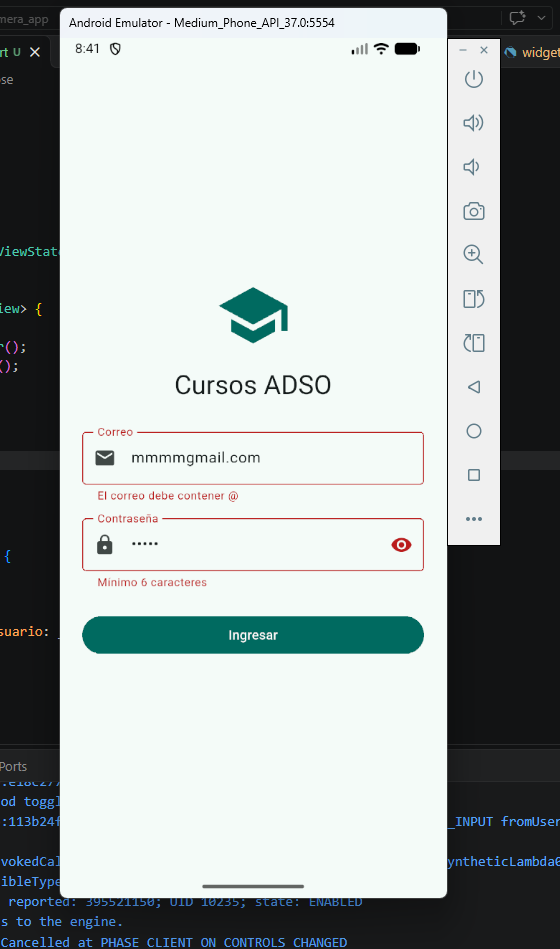
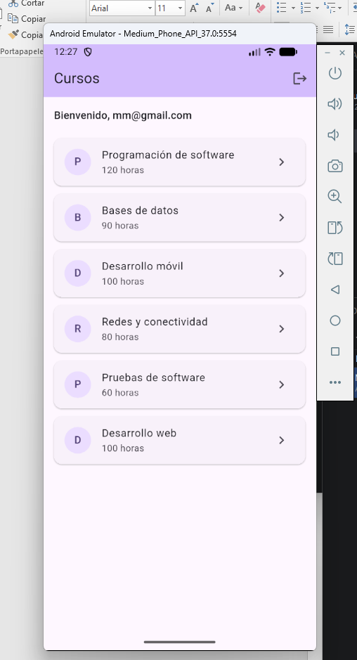
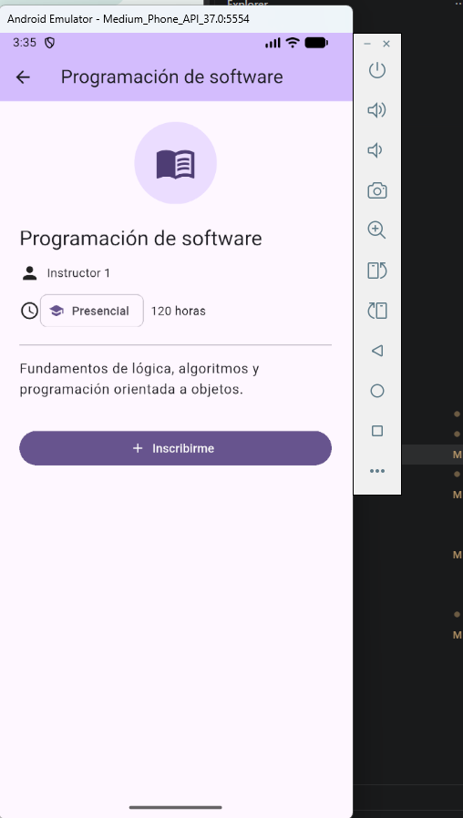
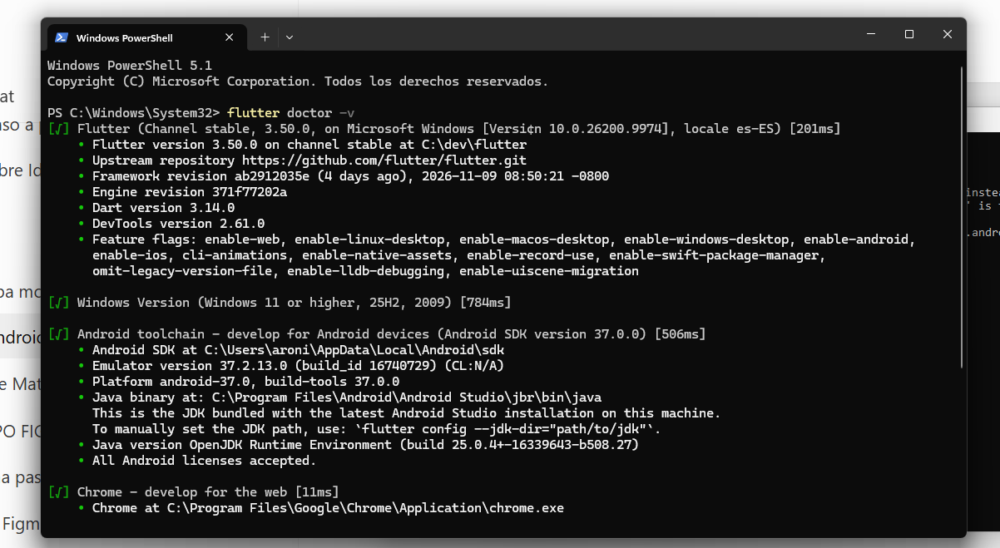
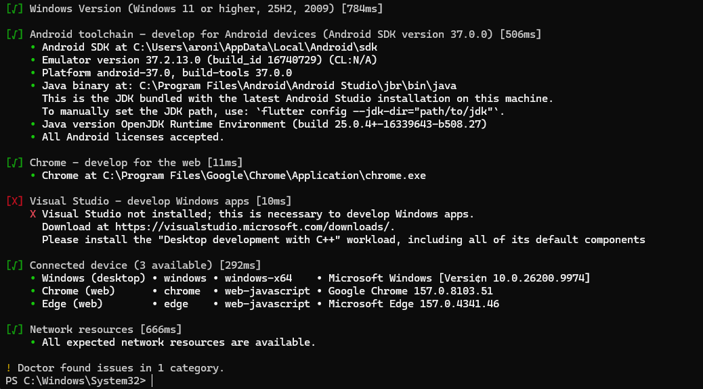
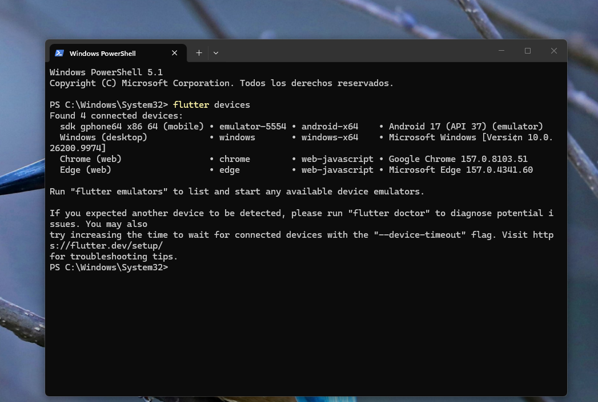

# Cursos ADSO

**Aprendiz:** Mary Sol Jiménez

**Programa:** Análisis y Desarrollo de Software Ficha 3388984.
## Descripción
Aplicación móvil desarrollada en Flutter como proyecto de formación del SENA.

## Descripción
Aplicación móvil desarrollada en Flutter como proyecto de formación del programa Análisis y Desarrollo de Software (ADSO) del SENA.

La aplicación permite iniciar sesión, consultar una lista de cursos y visualizar los detalles de cada curso.

## Funcionalidades
- Inicio de sesión con validación de campos.
- Visualización de cursos disponibles.
- Consulta de los detalles de cada curso.
- Información sobre la modalidad de cada curso (presencial o virtual).

## Tecnologías utilizadas
- Flutter
- Dart
- Visual Studio Code
- Android Studio

## Capturas de pantalla

### Inicio de sesión

### Lista de cursos

### Detalle del curso

## Evidencias de configuración

### Flutter Doctor

### Segunda parte de Flutter Doctor

### Flutter Devices

## Instrucciones de ejecución

Para ejecutar el proyecto en un equipo que tenga Flutter instalado:

1. Clonar o descargar el repositorio de GitHub.
2. Abrir la carpeta del proyecto en Visual Studio Code.
3. Abrir una terminal en la carpeta del proyecto.
4. Ejecutar el siguiente comando para instalar las dependencias:

   flutter pub get

5. Ejecutar la aplicación con:

   flutter run
